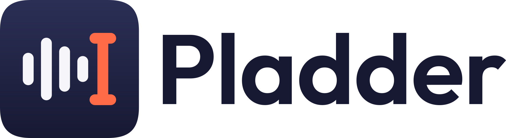
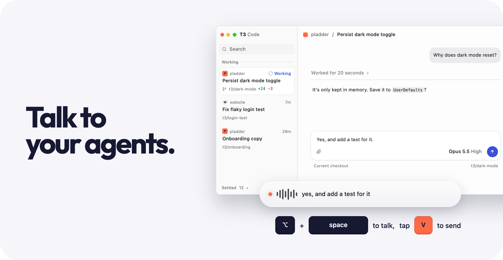
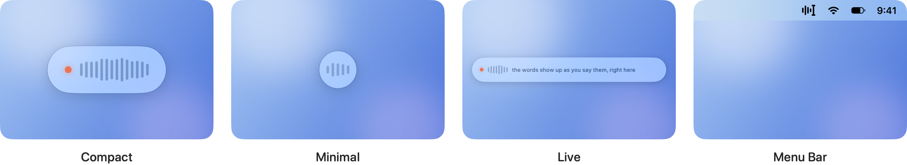

<h1 align="center">
  <picture>
    <source media="(prefers-color-scheme: dark)" srcset="Assets/logo-dark.svg">
    
  </picture>
</h1>

<p align="center">
  <picture>
    <source media="(prefers-color-scheme: dark)" srcset="docs/images/readme-hero-dark.png">
    
  </picture>
</p>

<p align="center">
  <strong>Push-to-talk dictation for Mac.</strong><br>
  Say the prompt, let go, and it's in T3 Code, Claude or Codex in <a href="docs/BENCHMARKS.md#what-a-dictation-waits-for">0.2 seconds</a>.<br>
  Free, and nothing you say leaves your Mac.
</p>

<p align="center">
  <a href="https://github.com/dinooo13/pladder/releases/latest/download/Pladder.dmg"></a><br>
  <sub>Free · No subscription · Works offline · macOS 26+ on Apple Silicon</sub>
</p>

<p align="center">
  <a href="INSTALL.md"></a>
  <a href="INSTALL.md"></a>
  <a href="LICENSE"></a>
  <a href="https://github.com/dinooo13/pladder/actions/workflows/ci.yml"></a>
</p>

<p align="center">
  <a href="https://dinooo13.github.io/pladder/">Website</a> ·
  <a href="#blink-and-its-there">Speed</a> ·
  <a href="#talk-freely-nobodys-listening">Privacy</a> ·
  <a href="#others-rent-you-dictation-pladder-gives-it-to-you">Compare</a> ·
  <a href="#questions">FAQ</a> ·
  <a href="#install">Install</a> ·
  <a href="docs/USAGE.md">Usage</a>
</p>

---

## Blink and it's there.

**[0.2 s](docs/BENCHMARKS.md#what-a-dictation-waits-for) from letting go to your words on screen.**

No spinning wheel, no “processing”, no upload. Your prompt is in the box the moment you let go, and your agent is working before you've looked up.

Measured on an M1, the oldest Mac it runs on: a median of [0.195 s](docs/BENCHMARKS.md#what-a-dictation-waits-for) over real dictations, and still [0.261 s](docs/BENCHMARKS.md#parakeet-ultra) after five minutes of talking. The recording is transcribed while you are still speaking, so by the time you let go there is almost nothing left to do. The engine is Parakeet Ultra, Moondream's post-training of NVIDIA's Parakeet TDT v3, on the Neural Engine through [FluidAudio](https://github.com/FluidInference/FluidAudio). It loads at launch and stays loaded, so the first dictation is as quick as the hundredth. Why it is fast: [docs/PERFORMANCE.md](docs/PERFORMANCE.md). How it is measured, and every number: [docs/BENCHMARKS.md](docs/BENCHMARKS.md).

## Say the detailed prompt, not the lazy one.

Typing makes you cut corners. Talking is three to four times faster, so you give your agent the context it actually needs.

| Typed | Said |
|---|---|
| `> fix dark mode bug` | `> The dark mode toggle in settings forgets its state after a restart. Save it, load it on launch, and add a test that flips it and relaunches.` |
| And then three rounds of “no, I meant…”. | **Right the first time.** |

- **~~clode code~~ → Claude Code.** A dictionary fixes the names speech models trip over: tools, libraries, your project's jargon.
- **Tap <kbd>V</kbd> before you let go.** Pladder pastes the prompt and presses Enter for you. Same hand, no reaching.

## Stop typing. Start talking.

Not just for agents. If there's a blinking cursor anywhere on your Mac, Pladder can fill it: T3 Code, Claude Code, Codex, OpenCode, Cursor and every terminal, but also emails, messages, notes and docs, and search boxes. Ask the long question, not the three-word one.

## Talk freely. Nobody's listening.

Your voice becomes text on your Mac, not on someone else's server. What you say about your code, your clients or your weekend stays with you.

Cloud dictation apps have a privacy policy pages long, because your voice goes to their servers. Ours is one line:

### Nothing you say leaves your Mac.

Offline · No account · Mic on only while you hold the key. There is no telemetry and no update check, and your clipboard is put back after the paste. The only requests Pladder ever makes are one-time model downloads from Hugging Face: the speech model on first launch, and S1-mini by Superwhisper only if you pick it for polish. After that it works with Wi-Fi off. Step by step: [docs/PRIVACY.md](docs/PRIVACY.md) and the [privacy page](https://dinooo13.github.io/pladder/privacy/).

## Others rent you dictation. Pladder gives it to you.

The popular dictation apps are subscriptions. Pladder is free, and it never sends your voice anywhere.

| | **Pladder** | Wispr Flow | Superwhisper |
|---|---|---|---|
| **Price** | **Free. No subscription.** | $15 a month for Pro | $8.49 a month for Pro |
| **Free plan limits** | **None. The best model is included.** | Weekly word cap | Whisper models only. Parakeet needs Pro. |
| **Speed** | **[0.2 s](docs/BENCHMARKS.md#what-a-dictation-waits-for), measured in public** | No public benchmark to rerun | No public benchmark to rerun |
| **Where your voice goes** | **Nowhere. It stays on your Mac.** | To their cloud servers | Your Mac, or the cloud with Pro cloud models |
| **Works offline** | **Always** | No | Only with local models |

<sub>Pro prices as listed on <a href="https://wisprflow.ai/pricing">Wispr Flow's pricing page</a> and <a href="https://superwhisper.com/docs/billing/plans">Superwhisper's plans page</a> in November 2026, billed monthly. Yearly plans cost less per month, and Superwhisper also sells a lifetime license. Check their sites for current terms.</sub>

## Simple as a walkie-talkie.

1. **Hold <kbd>⌥ Option</kbd> + <kbd>Space</kbd>.** Click into the prompt box, then hold. The mic turns on. Only now.
2. **Talk.** Like you'd explain it to a colleague. Say “comma” or “new paragraph” when you want one.
3. **Let go.** The text lands at the cursor. Tap <kbd>V</kbd> first to send it. Changed your mind? Press <kbd>Esc</kbd>.

## Four styles. Pick your pill.

A small Liquid Glass pill shows you're recording. Keep it compact, shrink it to a dot, watch your words appear live, or tuck it into the menu bar.

<p align="center">
  <picture>
    <source media="(prefers-color-scheme: dark)" srcset="docs/images/styles-dark.png">
    
  </picture>
</p>

## Little things you'll love.

- **No more “um”.** ~~“So, um, I think we should, uh, meet at noon”~~ → “So, I think we should meet at noon”.
- **Changed your mind?** ~~“See you Thursday, wait, no, Friday”~~ → “See you Friday”, with the optional polish, also on your Mac.
- **Learns your names.** Fix a word once and Pladder offers to remember it. Colleagues, pets, weird project names.
- **Your clipboard, untouched.** Whatever you'd copied is still there afterwards.
- **Your keys.** Record any push-to-talk or send key by pressing it, or add a toggle key for long dictations.
- **Out of your way.** Lives in the menu bar. Nothing in the Dock, no window to manage.
- **25 languages.** Hallo · Bonjour · Hola · Ciao. It notices which one you're speaking.

All of it is described in [docs/USAGE.md](docs/USAGE.md).

## Questions

<details>
<summary><strong>Which apps does it work with?</strong></summary>

Anything with a text field: T3 Code, Claude, Codex, Claude Code, Cursor, ChatGPT, your terminal, Mail, Messages, Notes. If you can type there, you can talk there.
</details>

<details>
<summary><strong>How do I dictate into Claude Code?</strong></summary>

Install Pladder, click into Claude Code's prompt, hold Option+Space, say the prompt and let go. The words are pasted at the cursor. Tap V while you still hold the keys and Pladder presses Return for you, so the prompt is sent. The same works in T3 Code, Codex, Cursor, OpenCode and every other app that takes text.
</details>

<details>
<summary><strong>Is there a free offline dictation app for Mac?</strong></summary>

Yes: Pladder. No trial, no subscription, no word limit, no ads, and it's open source under the MIT license. It runs entirely on your Mac, so after a one-time download of the speech model it works with Wi-Fi off.
</details>

<details>
<summary><strong>How is it different from Wispr Flow or Superwhisper?</strong></summary>

No subscription, no cloud, no account. Wispr Flow transcribes on its servers, and Superwhisper keeps its Parakeet models for Pro. Pladder gives you Parakeet for free, does everything on your Mac, and its speed is measured in public benchmarks anyone can rerun.
</details>

<details>
<summary><strong>How is it different from macOS Dictation and Whisper apps?</strong></summary>

Pladder is push-to-talk: it records only while you hold the key and pastes the whole text when you let go, into any app. It runs Parakeet Ultra, a post-training of NVIDIA's Parakeet TDT v3, rather than Whisper, and transcribes while you are still speaking, so the wait after you let go stays the same for a sentence or for five minutes.
</details>

<details>
<summary><strong>Will it run on my Mac, and in my language?</strong></summary>

Any Mac with an Apple chip, M1 or newer, on macOS 26 or later; the benchmarks are taken on an M1, so every newer chip is faster. It understands the 25 European languages of Parakeet, among them English, German, French, Spanish, Italian, Portuguese, Dutch, Polish and Ukrainian, and detects the language as you speak.
</details>

<details>
<summary><strong>Option+Space is my Alfred or Raycast hotkey, or I type non-breaking spaces with it.</strong></summary>

Both are lost while Pladder runs. Record another combination in Settings; see [push to talk](docs/USAGE.md#push-to-talk).
</details>

<details>
<summary><strong>Can another program use it for speech-to-text?</strong></summary>

Yes. `pladder-cli` transcribes an audio file and prints only the text. [docs/HERMES.md](docs/HERMES.md) sets it up for Hermes Agent's voice messages.
</details>

<h2 align="center">Talk is cheap. Pladder is free.</h2>

<p align="center">
  No trial, no subscription, no account.<br><br>
  <a href="https://github.com/dinooo13/pladder/releases/latest/download/Pladder.dmg"></a>
</p>

---

## Install

Pladder needs macOS 26 or later on an Apple Silicon Mac (M1 or newer). Download [`Pladder.dmg`](https://github.com/dinooo13/pladder/releases/latest/download/Pladder.dmg) from the [latest release](https://github.com/dinooo13/pladder/releases/latest), open it and drag Pladder to Applications. Each release also carries `Pladder.dmg.sha256` to check the download against.

Or build it from source in about a minute, with Xcode 26:

```sh
git clone https://github.com/dinooo13/pladder.git
cd pladder
./scripts/bundle.sh --install --run
```

Grant Microphone and Accessibility when asked, wait for the speech model to download once, then hold **Option+Space** in any text field and speak. Signing, updating, troubleshooting, using it without Accessibility and the command-line tool are in [INSTALL.md](INSTALL.md).

## Contributing

Issues and pull requests are welcome. [CLAUDE.md](CLAUDE.md) states what the project optimises for and the rule that every change on the release-to-paste path ships with a benchmark; [docs/BENCHMARKS.md](docs/BENCHMARKS.md) has the procedure. [docs/ARCHITECTURE.md](docs/ARCHITECTURE.md) explains how the code fits together, and [docs/MODELS.md](docs/MODELS.md) covers the model download.

## The name

*Pladder* is Low German (*Plattdeutsch*) for “to babble”. You just pladder into the microphone and the text gets pasted.

## License

MIT. See [LICENSE](LICENSE).

Parakeet TDT is by NVIDIA (CC-BY-4.0); Parakeet Ultra, its post-training, is by Moondream (CC-BY-4.0). FluidAudio is by FluidInference (Apache-2.0).
